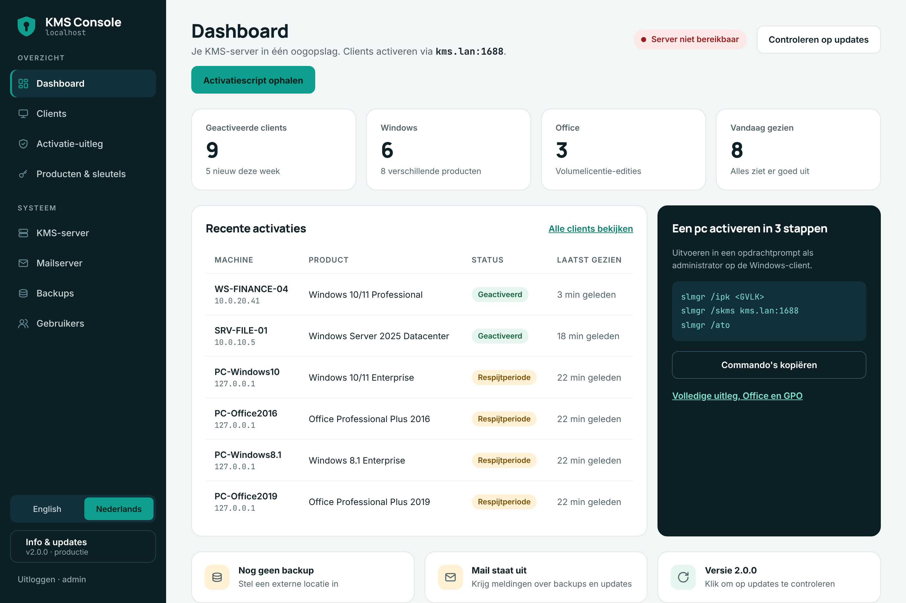
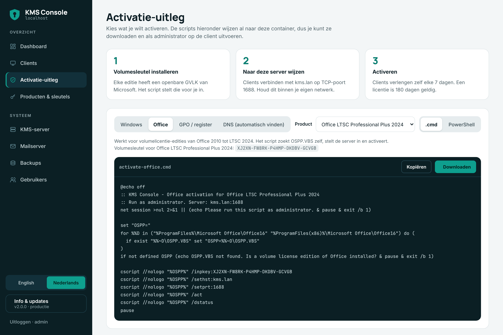

<p align="center"></p>

# KMS Console

A KMS server for Windows and Office volume activation, running as a **standalone LXC container** (Proxmox) instead of Docker, with a modern web GUI.

* **py-kms engine** as a systemd service, no Docker needed
* **Web GUI**: dashboard, activated clients, activation guide with ready-made scripts that point to your container, all products and GVLK keys
* **Activation scripts** for Windows (`.cmd` / PowerShell), Office 2010 to LTSC 2024, registry / Group Policy and DNS auto discovery
* **Backups**: full and incremental, to FTP, FTPS, SCP or SFTP, restore from the remote location, optional AES encryption, schedule
* **Mail**: your own SMTP server (STARTTLS, SSL/TLS, TLS 1.2+) for backup reports and update notices
* **Info & updates** in the GUI: version, update check, one-click update, switch between the production and test branch
* **English and Dutch** (Nederlands)





## Install on Proxmox

Run on the Proxmox host as root. This creates an unprivileged Debian 13 container and installs everything:

```bash
bash -c "$(curl -fsSL https://raw.githubusercontent.com/rhisijmuiden/kms/master/lxc/proxmox-create.sh)"
```

With your own settings:

```bash
curl -fsSLO https://raw.githubusercontent.com/rhisijmuiden/kms/master/lxc/proxmox-create.sh
bash proxmox-create.sh --hostname kms --ip 10.0.20.15/24 --gw 10.0.20.1 --bridge vmbr0 --vlan 20 --storage local-lvm
```

| Option | Default | |
| --- | --- | --- |
| `--ctid` | next free id | Container id |
| `--hostname` | `kms` | |
| `--debian` | `13` | Debian 13 or 12 template |
| `--storage` / `--disk` | `local-lvm` / `4` GB | Root disk |
| `--cores` / `--memory` | `1` / `512` MB | |
| `--bridge` / `--vlan` | `vmbr0` / none | Network |
| `--ip` / `--gw` / `--dns` | `dhcp` | Static IP in CIDR notation |
| `--branch` | `master` | Branch to install |
| `--console-port` | `8080` | Web GUI port |

Open `http://<container-ip>:8080` and create the administrator account.

### Install in an existing Debian container or VM

```bash
curl -fsSL https://raw.githubusercontent.com/rhisijmuiden/kms/master/lxc/install.sh | bash
```

## Activate clients

The **Activation guide** page in the GUI generates the scripts with the address of your container. In short:

```cmd
slmgr /ipk <GVLK>
slmgr /skms kms.lan:1688
slmgr /ato
```

Office (volume license editions):

```cmd
cscript "%ProgramFiles%\Microsoft Office\Office16\OSPP.VBS" /sethst:kms.lan
cscript "%ProgramFiles%\Microsoft Office\Office16\OSPP.VBS" /act
```

Or let clients find the server by themselves with a DNS SRV record:

```
_vlmcs._tcp.lan. 3600 IN SRV 0 0 1688 kms.lan.
```

Never expose port 1688 to the internet.

## How it is built

| Path | |
| --- | --- |
| `/opt/kms-console` | This repository (git checkout, used for updates) |
| `/opt/py-kms` | py-kms engine ([11notes/fork-py-kms](https://github.com/11notes/fork-py-kms)) |
| `/opt/kms-venv` | Python environment |
| `/var/lib/kms` | `kms.db` (activations), `console.db` (settings, users), `backups/` |
| `/etc/kms-console` | `kms.env` (KMS settings, managed by the GUI), `console.env` (GUI port), `secret.key` |
| `kms-server.service` | py-kms on port 1688, runs as user `kms` |
| `kms-console.service` | Web GUI (Flask + waitress), runs as user `kms` |
| `/usr/local/sbin/kms-ctl` | Root helper the GUI may call through sudo: restart, status, logs, update |

Passwords for SMTP and backup locations are stored encrypted (Fernet) with `secret.key`.

### Updates, production and test

The GUI updates itself from git. In **Info & updates** you choose the channel:

* **Production** follows branch `master`
* **Test** follows branch `test`

Branch names can be changed under **KMS server › Updates**. Before every update a full backup is made. From the shell: `kms-ctl check master`, `kms-ctl update test`, `kms-ctl update-log`.

### Backups

A backup chain starts with a full backup; each incremental only contains files that changed. A restore applies the full backup and every incremental up to the one you pick, after first making a safety backup. Remote locations: FTP, FTPS (explicit TLS), SCP and SFTP (password or SSH key, host key trusted on first use).

### Network & access

Under **System › Network & access** you choose how the web interface is reached:

* **Local network only**: `http://<ip>:8080`.
* **Own HTTPS with Caddy**: Caddy runs in the container and gets a Let's Encrypt certificate for your domain. Ports 80 and 443 must reach the container. Port 80 stays open for the certificate check; once HTTPS works you can close port 8080.
* **Behind a reverse proxy**: your proxy (Nginx Proxy Manager, Traefik, HAProxy) handles HTTPS and points to `http://<ip>:8080`. Only the proxy addresses you enter are trusted for `X-Forwarded-For`.

Both the web interface and the KMS port have their own access list. The KMS list works in every mode and blocks everything that is not on it; blocked addresses are shown for 7 days and can trigger an email. Public ranges wider than /24 and `0.0.0.0/0` are refused. The firewall is nftables inside the container (`kms-firewall.service` loads it at boot). In an unprivileged Proxmox container the `nf_tables` module must be loaded on the host.

Locked out of the web interface? Run `pct enter <id>` and `kms-ctl access-reset`.

### Useful commands

```bash
kms-ctl status
kms-ctl logs 100
kms-ctl reset-password admin
kms-ctl net-status
kms-ctl access-reset
journalctl -u kms-console -f
```

## Development

```bash
git clone --depth 1 --branch v1.0.3 https://github.com/11notes/fork-py-kms.git /tmp/py-kms
python3 -m venv .venv && . .venv/bin/activate
pip install -r app/requirements.txt pytest pyftpdlib pyopenssl
KMS_PYKMS_DIR=/tmp/py-kms/py-kms python -m pytest tests

# run the GUI locally
export KMS_DATA_DIR=/tmp/kms/data KMS_CONF_DIR=/tmp/kms/conf KMS_PYKMS_DIR=/tmp/py-kms/py-kms KMS_CTL= KMS_CONSOLE_PORT=8099
cd app && python wsgi.py
```

Translations live in `app/kmsconsole/translations/nl.json` (English text is the key). The house style is in [`branding/`](branding/huisstijl.md).

## Credits

* [py-kms](https://github.com/Py-KMS-Organization/py-kms) and the [11notes fork](https://github.com/11notes/fork-py-kms)
* Original Docker images: [11notes/docker-kms](https://github.com/11notes/docker-kms) and [11notes/docker-kms-gui](https://github.com/11notes/docker-kms-gui)
* Fonts: Inter, Manrope and JetBrains Mono (SIL Open Font License)
